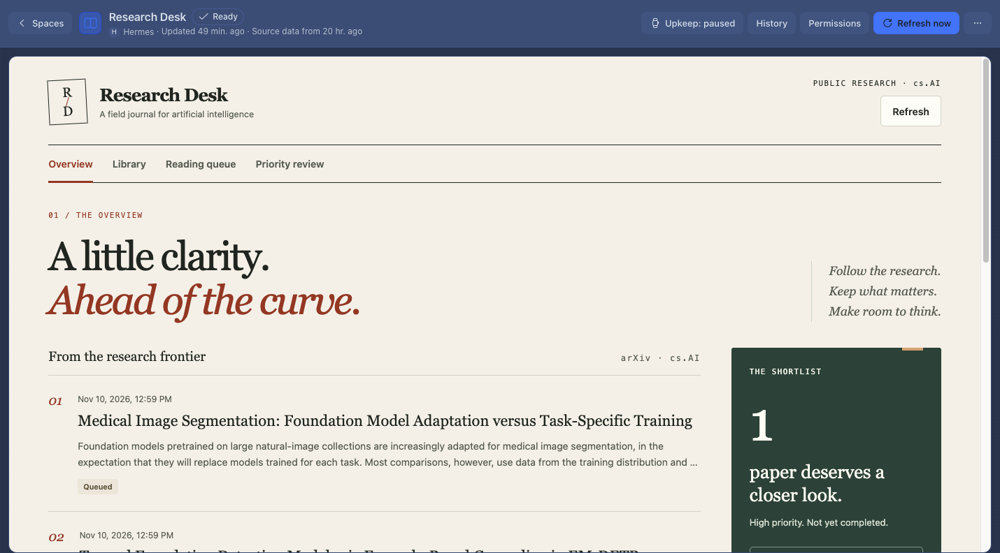
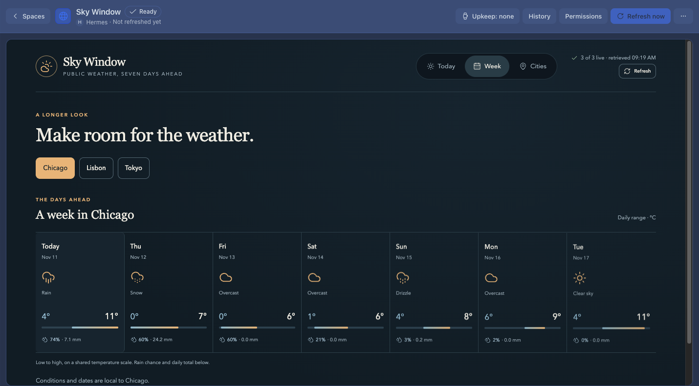
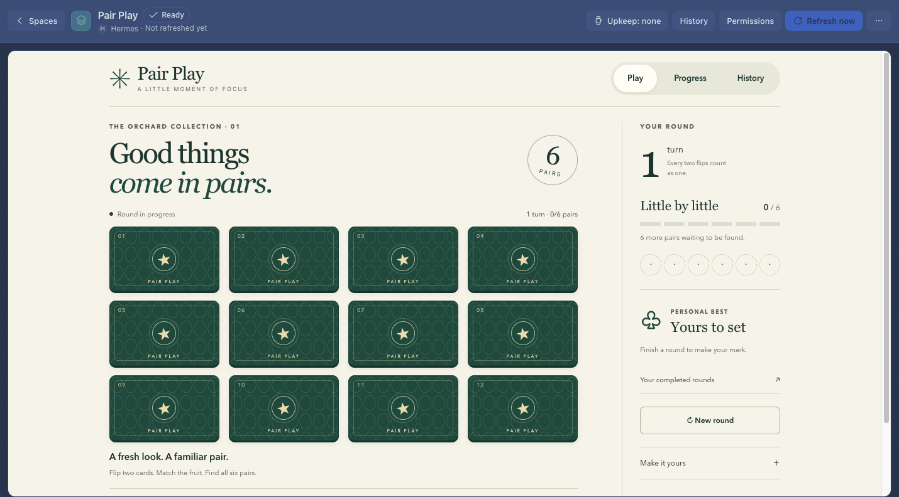

# Living Spaces

**Build an app in chat. Come back to it in Hermes Desktop.**

Living Spaces gives your Hermes bot a place to build things you can use again: a reading desk, a weather dashboard, or a little game. Open a Space from chat or the **Spaces** tab. When you want a change, ask in the same chat.

[Install Living Spaces](#install) · [See what you can build](#see-what-you-can-build)

[](docs/design/premium-pass/qualification-addendum-20261111/a-live-research-desk-desktop.png)

*Research Desk in Hermes Desktop. Save papers to a reading queue and keep a shortlist for later.*

## Make your first Space

After [installing](#install), start a Hermes chat with Living Spaces enabled and try:

> Build a reading desk with a searchable library and a reading queue. Use sample papers so I can try it right away.

1. Select **Open Space** in the bot's reply.
2. Add a paper to your queue. Leave the Space and reopen it from **Spaces** to find your saved queue.
3. In the same chat, ask for a change, such as a filter for papers you have finished.

What the bot builds depends on your request and model, so your Space will look different from the examples below.

## See what you can build

### Sky Window

A week of daily temperature ranges and rain chances, with a tab for each city you follow. This screenshot shows an earlier public forecast.

[](docs/design/premium-pass/qualification-addendum-20261111/a-live-sky-week-desktop.png)

### Pair Play

A quiet memory game: flip two cards at a time and find all six pairs while the board tracks your turns.

[](docs/design/premium-pass/qualification-addendum-20261111/a-live-pair-play-desktop.png)

## Requirements

- Hermes 0.23.1 or later
- Hermes Desktop
- Qualified on macOS

## Install

Run these commands in the Hermes profile where you want Living Spaces. This installs the reviewed plugin revision from its subdirectory, then enables it:

```sh
hermes plugins install akinduroifedayo/living-spaces/src/living-spaces --ref 8134be424b5a5756a89278e729ab537475f45155 --no-deps --no-enable
hermes plugins enable living-spaces
```

In Desktop, enable **Living Spaces** under **Capabilities > Plugins**, then open **Spaces**. The CLI and Desktop switches enable different parts of the plugin; use both.

### Manual install

You can also clone the repository and copy the plugin into an empty destination in your selected profile. Set `HERMES_HOME` first if you use a non-default profile.

```sh
git clone https://github.com/akinduroifedayo/living-spaces.git
cd living-spaces
git checkout --detach 8134be424b5a5756a89278e729ab537475f45155
plugin_home="${HERMES_HOME:-$HOME/.hermes}"
mkdir -p "$plugin_home/plugins"
test ! -e "$plugin_home/plugins/living-spaces" && \
  cp -R src/living-spaces "$plugin_home/plugins/living-spaces"
hermes plugins enable living-spaces
```

Then enable the Desktop switch described above. The plugin lives in `src/living-spaces`; the repository root is not the plugin package.

The [package README](src/living-spaces/README.md) explains usage, saved data, upkeep, and removal.

## For contributors

- [Plugin guide](src/living-spaces/README.md): data, upkeep, and removal.
- [Contributing guide](AGENTS.md): source layout, builds, and checks.
- [Specification](docs/spec/SPEC.md) and [amendments](docs/spec/AMENDMENTS.md): product scope.
- [Desktop verification](docs/verification/DESKTOP.md): run the note-save and reopen check.
- [Release status](docs/evidence/R1-STATUS.md): see what has been tested.

## License

Living Spaces is licensed under the [MIT License](LICENSE), copyright Living Spaces contributors. Vendored libraries and fonts retain their own licenses. See the [third-party notices](src/living-spaces/THIRD-PARTY.md).
