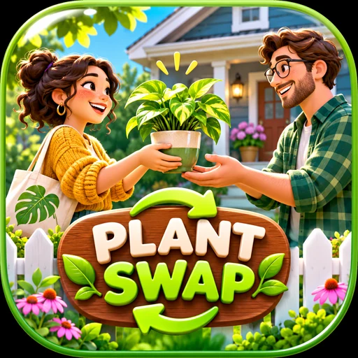
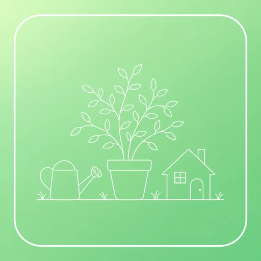

# Space icon guide

Every Space gets one generated icon. It appears on the Spaces landing card (40 px caption, 72 px when there's no snapshot), the floating island and Details header (24 px), the Details hero (96 px) and the smallest 16–20 px tile. The host makes them a family. Your job is to supply one clean symbol.

**Contract in one line:** generate *one matte white object on a flat accent field*, filling the template below. The host adds everything else.

## 1. Who draws what

| You generate (the image) | The host adds (never draw these) |
|---|---|
| A flat, uniform field in the accent's field colour, edge to edge | The squircle shape and its mask |
| One white object, centred, inside the safe area | The light ramp across the tile (top lighter, bottom deeper) |
| Soft matte form shading, light from the upper left | Edge stroke, drop shadow, glass and sheen |
| Nothing else | Optical crop-in at small sizes, dark-mode edge |

Why: image models return opaque squares. A model-drawn tile comes back with white corners, its own gradient and a glossy 2012 sheen, and no two tiles agree. When the field is flat, the host can mask, ramp and crop the image so every Space sits in one system.

## 2. House style

- **Material:** smooth matte white porcelain. Soft form shading only. No gloss, specular highlight, reflection, glow or outline.
- **Light:** from the upper left. Shadowed planes fall lower-right in a cool light grey. No cast shadow and no floor.
- **Field colour:** exactly one of the 8 accent field colours (§3). Flat: no gradient, vignette, texture or noise.
- **Subject:** one object, simplified to its most recognisable silhouette, chunky and bold. Choose a thing, not a scene.
- **Size:** the object covers about 15–30% of the area. Its bounding box spans 55–65% of the width and sits centred. The outer 20% on every side stays empty (the hard limit the checks enforce is 12%).
- **Weight:** parts thinner than about 1/30 of the canvas vanish at 20 px. Prefer solid masses to struts, and few parts to many.
- **Never:** text, letters, numbers, logos, a second object, a frame, a tile, rounded corners, a border, people or a background scene.

## 3. Palette: accent → field colour

Use the Space's `accent` and paste its field colour into the template. These are the mid stops of the host ramp, so the image blends into the host's own light. White on each field measures ≥ 4.1:1.

| accent | field | white on field |
|---|---|---|
| blue | `#2A61D7` | 5.53:1 |
| green | `#238B66` | 4.22:1 |
| amber | `#B06A2A` | 4.25:1 |
| purple | `#7E71BA` | 4.26:1 |
| teal | `#00879E` | 4.22:1 |
| rose | `#D83F63` | 4.36:1 |
| orange | `#C16235` | 4.16:1 |
| grey | `#7C7C85` | 4.12:1 |

## 4. Choosing the subject

1. Name what the Space is *about*, not what it does: a moon for a night-sky Space, not a telescope pointing at a chart.
2. Pick the object that names it at a glance. Use a concrete noun with a famous silhouette: book, briefcase, die, coin stack, sprout, paper plane, vinyl record, running shoe, crescent moon.
3. If two ideas compete (a trip *and* its temple), choose one. The checks fail two-subject marks at 20 px.
4. Abstract topics take a classic diagram object: a knowledge graph is "four round nodes joined by thick straight links, one node in the centre."
5. Also choose a fallback `glyph` from the host kit that's close in meaning (§7). It shows if the image fails.

## 5. The prompt template

Fill the three slots. Do not edit the fixed text. Call `image_generate` with `aspect_ratio: "square"`.

```
App icon symbol: {SUBJECT}. It stands for {METAPHOR}. One single bold object, simplified to its most recognisable silhouette, centred, filling about 60% of the frame. Keep the outer 20% of every edge completely empty. Render the object as smooth matte white porcelain with soft form shading: light from the upper left, a gentle cool grey on the lower-right planes. No gloss, no shine, no specular highlights, no reflections, no outlines, no glow. Background: one perfectly flat, uniform, solid {FIELD} colour that fills the whole square edge to edge. No gradient, no vignette, no texture, no frame, no tile, no rounded corners, no border, no drop shadow, no cast shadow, no floor. No text, letters, numbers or logos. No second object. Square 1:1.
```

- `{SUBJECT}`: the object, plus one clause of shape detail if it disambiguates ("a single six-sided die showing three pips on top").
- `{METAPHOR}`: what it stands for in 2–5 words ("games for two"). It steers the model's styling and is never drawn.
- `{FIELD}`: the hex from §3 for the Space's accent.

Worked examples (all passed first time on gpt-image-2):

| Space | accent | SUBJECT | METAPHOR |
|---|---|---|---|
| GBrain Cockpit | teal | a knowledge graph of four round nodes joined by thick straight links, one node in the centre | a personal knowledge brain |
| Faultline Atlas | purple | a globe split by one bold zigzag crack | earthquakes and a moving Earth |
| Thailand readiness | purple | a paper plane | getting ready for a trip |
| Pair Play | orange | a single six-sided die showing three pips on top | games for two |
| Household budget | green | a short stack of three coins | a monthly budget |

## 6. Save, check, retry, fall back

1. Generate with the template.
2. Save the result into the Space as `assets/icon.webp`. `image_generate` returns a file in the Hermes image cache: pass it as `"assets/icon.webp": {"from_path": "<that path>"}` in `files` (inline `{"b64", "mime"}` also works). The host re-encodes it to 512 × 512 WebP at that path.
3. Reference it in the manifest:
   ```json
   "icon": { "image": "assets/icon.webp", "glyph": "sprout" }
   ```
4. The build result carries `icon_check` (`pass`, `attempt`, `fails`, `fallback`, `next`). If it says `"pass": false`, read `fails`, fix the cause in the slots (usually a simpler subject), and regenerate **once**.
5. If the second image also fails, stop. Keep the `glyph` in the manifest; the host shows it. Tell the user in one line: "The icon didn't pass the checks, so the Space uses the ‘sprout’ glyph for now."

Never retry more than once, change provider, or use a paid fallback to get an icon. A glyph is a finished result.

## 7. Acceptance checks (the host runs these at save time)

| Check | Rule | Typical cause of failure |
|---|---|---|
| format | PNG or WebP | JPEG, SVG or GIF |
| square | width = height | wrong aspect ratio |
| size | 512–2048 px on input; stored at 512 px | a thumbnail-sized image |
| file cap | ≤ 512 KiB stored | photographic detail |
| opaque | no transparency | a cut-out was requested |
| flat field | ring colour spread ≤ 0.025 (OKLab) | gradient, vignette, frame |
| own tile | corners match the field (≤ 0.05) | the model drew a rounded tile |
| on-palette | field within 0.09 of the accent's field colour | wrong or invented colour |
| safe area | the mark's bounding box sits within 12%–88% | the subject touches the edges |
| centred | centroid and box centre within 8% of the middle | the subject drifts to one side |
| coverage | the mark covers 10–50% of the area | too small (line art) or a scene |
| contrast | mark vs field ≥ 3:1 (WCAG) | a coloured or grey subject |
| 20 px legibility | at 20 × 20, ≥ 40% of the mark's pixels stay solid and ≥ 12% of the tile is solid mark | hairlines, many small parts |

A missing file or one that won't decode at load counts as a failure: the host shows the glyph and logs once.

**Resolution order in the host:** passing `icon.image` → `icon.glyph` (kit, or a legacy alias) → deterministic sigil from the Space id. Old string icons (`"icon": "globe"`) still resolve through the kit's alias table. A tile is never blank or broken.

## 8. Do and don't

| ✓ Do | ✕ Don't |
|---|---|
|  **One bold object.** Reads at 16 px. |  **Two subjects.** Plane plus temple: illegible at 16. |
|  **Matte form, flat field.** Soft light, no shine. |  **Your own tile and gloss.** White corners, a gradient, a sheen: fails 6 checks. |
|  **Inside the safe area.** The host can crop and mask. |  **Scenes and lettering.** 82% coverage, 1.67:1 contrast. |
| |  **Thin line art.** 2% coverage; nothing survives at 20 px. |
